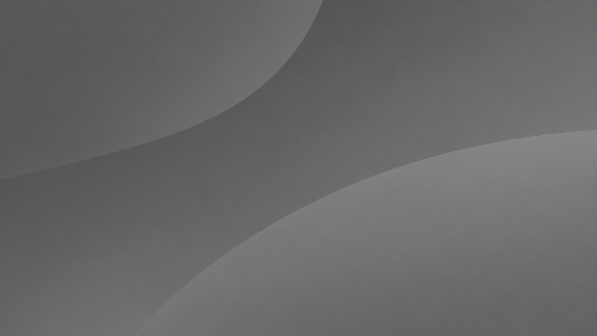

# DropUI Next

Transformasi identitas sistem dan aset antarmuka **DropUI Next** berbasis Arch Linux & KDE Plasma 6.

<p align="center">
  
</p>

## Fitur Utama
* Pembersihan aset bawaan lama dan pemasangan wallpaper **DropUI Next** (`DropUI-Default` & `DropUI-Next`).
* Rebranding identitas sistem (`os-release`, `About System`, `hostname`, dan layar *boot* Plymouth) menjadi **DropUI Next** dengan tetap mempertahankan basis murni **Arch Linux**.

## Preview Wallpaper

| DropUI Default | DropUI Next |
| :---: | :---: |
|  |  |

## Cara Instalasi
```bash
git clone https://github.com
cd DropUI-Next
chmod +x install.sh
./install.sh
```
